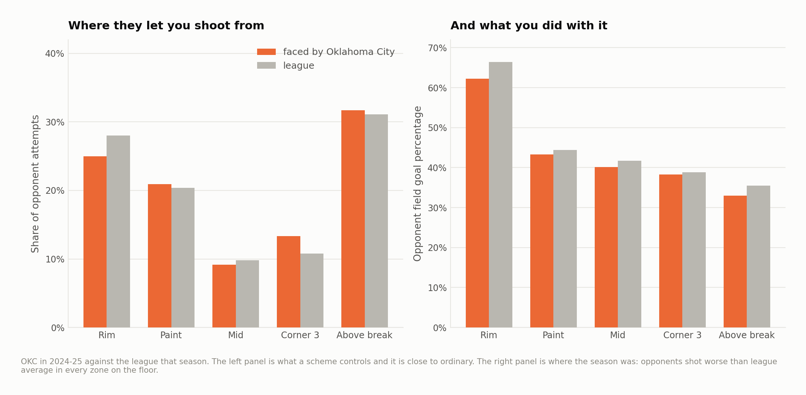
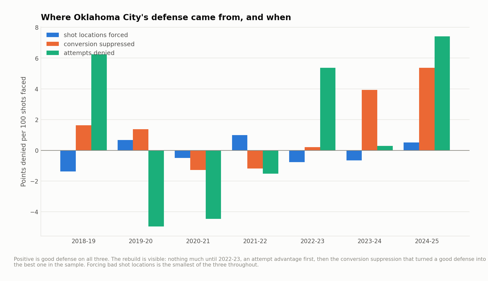

# The best defense a shot chart has ever seen

San Antonio and Oklahoma City met in the 2026 Western Conference finals and it
went seven. This is about the season before that one — 2024-25, the last full
season the public shot-chart mirror covers — and about what a scouting
department could have known from it.

Twenty-two seasons, 4,432,054 shot attempts, 26,453 games, 659 team-seasons,
2003-04 to 2024-25.

**Oklahoma City's 2024-25 defense took more points off the board than any team
in the sample. It is not the best shot defense in the sample. Those two
sentences are the project.**

---

## A shot file sees two of the four things a defense does

A defense makes you shoot from bad places, makes you miss from good ones, takes
the ball away before you shoot at all, and keeps you off the offensive glass. A
file of shot attempts sees the first two directly.

It sees the other two as an **absence**. Both teams in a game get roughly the
same number of possessions, so a team that shoots more often than its opponents
has either taken the ball away or got it back off the rim. That shortfall — the
attempt differential — is the only trace a turnover leaves in a file that records
only shots, and it turns out to be enough.

Everything below is in points per game against that season's league average, so
the two channels can be added.

---

## Where the great defenses live


The horizontal axis is the shot chart. The vertical axis is the attempts.
Twenty-two seasons of defenses are on it, and the shape is the finding: the
famous ones are on the **right**, and almost none of them is also **up**.

| | Shot defense | Attempt differential |
|---|---|---|
| 2012-13 Indiana | −8.67 | −1.77 |
| 2013-14 Indiana | −8.25 | −2.52 |
| 2019-20 Milwaukee | −7.94 | −2.84 |
| 2007-08 Boston | −7.93 | −0.52 |
| 2003-04 San Antonio | −7.58 | +0.70 |

*(Shot defense in points per 100 attempts faced; negative is good. Attempt
differential in attempts per game; positive is good.)*

Those teams won by making you miss and then giving you the ball back. In
twenty-two seasons, exactly **five** team-seasons cleared −4 on the shot chart
*and* +3 in attempts at the same time. Oklahoma City's is the largest of the five
by a distance.

---

## What Oklahoma City did

| | Value | League rank |
|---|---|---|
| Shot locations forced | −0.50 per 100 | 9th |
| Conversion suppressed | **−5.37 per 100** | **1st** |
| Both together | **−5.88 per 100** | **1st** |
| Attempt differential | **+5.89 a game** | **1st** |
| **Points denied per game** | **11.51** | **1st of 659** |


Eleven and a half points a game against league average, and the next entry in
twenty-two seasons is the 2009-10 Bucks at 10.19. About 5.1 of it is the shot
chart and about 6.4 of it is never letting the shot happen.

The zone-by-zone picture says what kind of defense that is:



| Opponent attempts | Share | League | Conversion | League |
|---|---|---|---|---|
| At the rim | 25.0% | 28.0% | **62.2%** | 66.4% |
| Paint, off the rim | 20.9% | 20.4% | 43.3% | 44.4% |
| Mid-range | 9.2% | 9.8% | 40.2% | 41.7% |
| Corner three | 13.3% | 10.8% | 38.3% | 38.8% |
| Above the break | 31.7% | 31.1% | **33.0%** | 35.5% |

They take three points of rim attempts away and hand back two and a half points
of corner threes, which is close to an even trade and is why their *location*
number is ordinary. Then their opponents shoot below league average in **every
zone on the floor**.

---

## The part a front office should discount


Run every component against the same team's next season across 624 consecutive
pairs. Opponent shooting is measured against that season's league average, so
the league-wide rise in two-point percentage does not count as a team repeating
itself:

| | Repeats at |
|---|---|
| Shot locations forced | 0.66 |
| Opponent two-point percentage | **0.58** |
| Points denied per game | 0.51 |
| Conversion suppressed | 0.51 |
| Attempt differential | 0.44 |
| Opponent three-point percentage | **0.19** |

A defense keeps a good part of the two-point percentage it allowed and very
little of the three-point percentage. That is not a small technicality here,
because Oklahoma City's conversion edge splits almost exactly in half across
that line:

- **−2.81 per 100 from twos.** Opponents shot 51.3% inside the arc. This is the
  half that repeats.
- **−2.57 per 100 from threes.** Opponents shot 34.5% against a league average of
  36.3%. This is the half that does not.

At 86.6 attempts faced per game, that second half is worth about **2.2 points a
game** — and it sits on a component with a year-to-year correlation of 0.19.
Anything projecting this defense forward should hand those back and then decide
whether what is left is still frightening.

It is. Take out the three-point half entirely and they are still at about 9.3
points a game, which exactly one other team-season in twenty-two years beats —
and that team, the 2009-10 Bucks, got there almost wholly on attempts.

---

## How it was built



The attempt advantage came first and it is not new: the 2018-19 Thunder led the
league in points denied on the strength of a +5.24 attempt differential with an
ordinary shot chart. It vanished in the rebuild — 30th in 2020-21 — and came
back in 2022-23. The conversion suppression is the recent part, arriving in
2023-24 and doubling in 2024-25.

Which is the honest version of the scouting note: one half of this defense is a
four-season organizational trait, and the other half is two seasons old.

---

## The Western tier, 2024-25

| | Shot defense | Attempt differential | Points denied |
|---|---|---|---|
| **Oklahoma City** | **−5.88** | **+5.89** | **11.51** |
| Houston | −2.92 | +5.00 | 8.02 |
| Golden State | −0.34 | +3.43 | 4.03 |
| Minnesota | −2.23 | −0.33 | 1.60 |
| LA Lakers | −0.76 | −3.77 | −3.43 |
| Denver | −0.37 | −3.54 | −3.51 |
| San Antonio | +1.76 | −2.77 | −4.64 |

Two of the West's three best defenses by this measure were built the same way,
and Houston is the only other team in the league that gets near Oklahoma City on
attempts. San Antonio's own 2024-25 number is the worst of the seven, in a season
their defensive centerpiece missed the second half of.

---

## What this is not

- **Not a defensive rating.** No free throws, no possessions, no pace. A defense
  that fouls is invisible here, and a team that plays fast will look like it
  denies more points a game than the same team playing slow.
- **The attempt differential is two things at once.** Turnovers forced and the
  offensive rebounding battle are added together in it and nothing here
  separates them. Both are real defense; they are not the same skill and they do
  not have the same shelf life.
- **Conversion is contest quality and luck in unknown proportions.** The
  stability table bounds how much of it to believe. It does not identify which
  half of any particular season was which.
- **Regular season only, through 2024-25**, which is where the mirror ends.
  Nothing here is about a playoff series, including the one these two teams
  played.

---

## Running it

```bash
pip install -r requirements.txt
python src/run_01_build.py     # 22 season files -> team profiles, both sides
python src/run_02_defence.py   # the decomposition, the stability check, figures 01-05
```

Or `make all`. Under a minute once the raw files are on disk.

```
src/
  config.py        paths, seasons, the subject
  defence.py       the two channels, and how each is priced
  labels.py        collision-resolving point labels
  style.py         one place that decides what every figure looks like
  run_0*.py        the pipeline, in order
output/            every number quoted above, as CSV
figures/           five figures, regenerated from scratch by the pipeline
docs/method.md     longer notes, including what the attempt differential is really measuring
```

## Data

Shot-level data from
[DomSamangy/NBA_Shots_04_24](https://github.com/DomSamangy/NBA_Shots_04_24), a
mirror of the league's public shot chart endpoint. `data/README.md` has the fetch
step and the list of what a shot file cannot see.

## License

MIT. See `LICENSE`.
