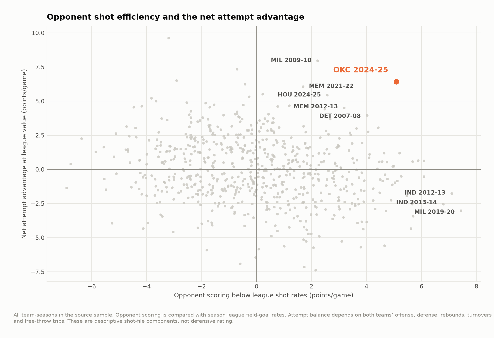
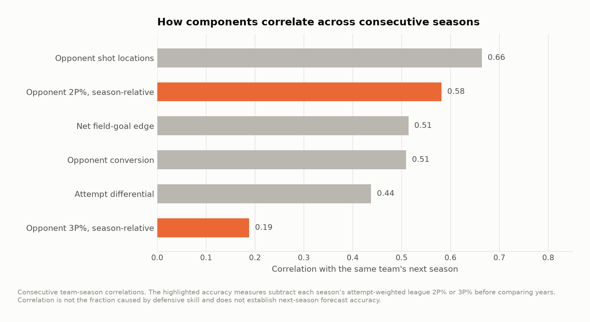

# Oklahoma City: opponent shot efficiency and attempt balance

Oklahoma City's 2024–25 shot-file results combine low opponent scoring per attempt with more field-goal attempts than its opponents. Those are useful components to describe, but their sum is not a defensive rating.

The decomposition compares each team's opponents with that season's league field-goal rates. Location measures the value of the observed zone mix; conversion measures the remaining difference in scoring from those zones. Neither component identifies a defensive scheme's causal contribution.



## Correct definition of the combined measure

**Net field-goal edge** = opponent field-goal points below league shot rates + the team's net attempt advantage valued at the league's points per attempt.

Attempt balance includes both teams' offense, defense, rebounding, turnovers and free-throw trips. Additional offensive rebounds can improve this measure without any change to opponent shot defense. It excludes free-throw points, pace adjustment and opponent-strength adjustment. Use it as a descriptive field-goal balance, not a ranking of total defense.

| Season | Location | Conversion | Total | Att diff | Net fg edge |
|---|---|---|---|---|---|
| 2008–09 | 1.202 | 1.505 | 2.707 | -1.049 | -3.288 |
| 2009–10 | 1.098 | -4.556 | -3.458 | -0.902 | 1.911 |
| 2010–11 | 0.570 | -1.480 | -0.910 | -2.378 | -1.627 |
| 2011–12 | 0.707 | -5.182 | -4.475 | -5.818 | -1.894 |
| 2012–13 | 0.427 | -5.928 | -5.501 | -5.610 | -0.933 |
| 2013–14 | 1.250 | -3.952 | -2.703 | -0.683 | 1.557 |
| 2014–15 | 1.177 | -2.692 | -1.515 | 1.305 | 2.590 |
| 2015–16 | 0.945 | -4.670 | -3.725 | -1.232 | 2.010 |
| 2016–17 | 0.830 | -1.258 | -0.428 | 2.134 | 2.564 |
| 2017–18 | 1.447 | -0.594 | 0.852 | 4.037 | 3.513 |
| 2018–19 | 1.375 | -1.628 | -0.253 | 5.244 | 5.739 |
| 2019–20 | -0.671 | -1.366 | -2.037 | -4.167 | -2.603 |
| 2020–21 | 0.493 | 1.279 | 1.772 | -3.778 | -5.697 |
| 2021–22 | -0.984 | 1.181 | 0.198 | -1.280 | -1.544 |
| 2022–23 | 0.762 | -0.212 | 0.549 | 4.317 | 4.238 |
| 2023–24 | 0.661 | -3.934 | -3.273 | 0.232 | 3.165 |
| 2024–25 | -0.502 | -5.374 | -5.876 | 5.890 | 11.506 |

Source: [okc_path.csv](output/okc_path.csv).


## Does opponent accuracy persist?

The revised comparison subtracts the attempt-weighted league 2P% or 3P% within each season before correlating consecutive team-seasons. Raw correlations are retained for comparison.

| Label | Pairs | Year over year r |
|---|---|---|
| Opponent 2P%, season-relative | 624 | 0.582 |
| Opponent 3P%, season-relative | 624 | 0.188 |
| Opponent two-point percentage | 624 | 0.849 |
| Opponent three-point percentage | 624 | 0.164 |
| Conversion denied on twos | 624 | 0.559 |
| Conversion denied on threes | 624 | 0.186 |

Source: [accuracy_stability.csv](output/accuracy_stability.csv).

The large raw two-point correlation partly reflects the league's changing accuracy over time. The season-relative association remains positive, but correlation does not tell us what fraction is defensive skill. Roster continuity, opponent mix and sampling variation also matter. This is a retrospective persistence check, not an evaluated next-season forecast.



## Basketball use

The zone profile directs attention to where opponent efficiency differed from league rates. Film and possession-level data are needed to distinguish contested finishes, rotations, transition defense and opponent shooting variance. A complete defensive evaluation must also account for free throws, turnovers, rebounds and possession counts.

The sample ends in 2024–25; team labels and rankings refer to that historical sample.


## Reproduce

The historical analysis used Python 3.12 with the pinned dependencies below. From this repository:

```bash
python3.12 -m venv .venv
source .venv/bin/activate
python -m pip install -r requirements.txt
make fetch-data PY=python
make all PY=python
make report site PY=python
```

`make all` verifies source hashes before running the analyses in order. A missing or changed input stops the build. Data downloads need network access; article rendering uses the included result tables. See [the source manifest](data/source_manifest.json), [method notes](docs/method.md) and [current validation record](VALIDATION_CURRENT.md) for the distinction between a source rebuild and checks of delivered outputs.

Season keys in CSV files use the **ending year**: `2025` means 2024–25. Display tables use full season labels. The MIT license covers code; third-party data retain their providers' rights and terms.

[Portfolio](https://github.com/jmsmarrelli/basketball-analytics) · [AI assistance and provenance](PROVENANCE.md)
